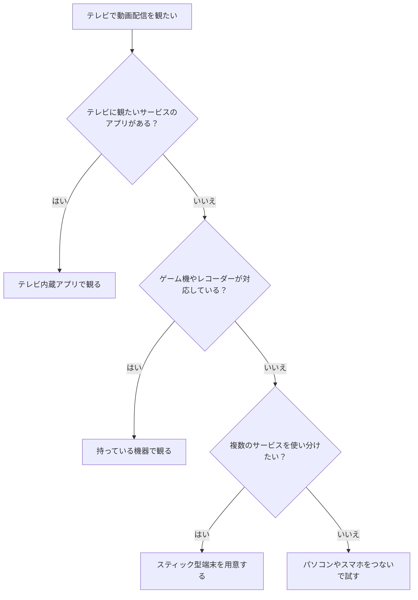

## 結論：迷ったら「スティック型端末」か「テレビ内蔵アプリ」

動画配信サービスをテレビで観る方法は、大きく分けて5つあります。それぞれに向き不向きがありますが、**迷ったら、スティック型端末を使う方法か、テレビに入っているアプリを使う方法**から検討するのがおすすめです。

理由は、どちらも**リモコンで操作でき、普段のテレビの延長で使える**からです。パソコンやスマホをつなぐ方法は手軽ですが、毎回の準備が必要で、観るたびに手間がかかります。

この記事では、年間約200〜300本を自宅で観ていて、テレビにスティック型端末を挿して動画配信を楽しんでいる筆者が、**テレビで動画配信を観る5つの方法と、選び方**を整理します。

なお、テレビのメーカーや年式、端末の種類によって、使えるサービスや機能は変わります。この記事では一般的な考え方を説明するので、**自分の機器で使えるかどうかは、メーカーや各サービスの公式情報で確認**してください。

## テレビで動画配信を観る5つの方法

### 方法1：スティック型端末をテレビに挿す

テレビの**HDMI端子にスティック型の端末を挿して**、動画配信のアプリを使う方法です。筆者もテレビにスティック型端末を挿して観ています。

**メリット**
- リモコンで操作でき、普段のテレビ感覚で使える
- 複数のサービスのアプリを、ひとつの画面から切り替えられる
- 比較的手頃な価格のものが多い
- 古いテレビでも、HDMI端子があれば使える場合が多い

**デメリット**
- 端末を別に買う必要がある
- 端末の性能によって、起動や操作の速さが変わる
- Wi-Fi環境が必要になる

複数のサービスを使い分けている人には、特に便利です。リモコンで切り替えられるので、サービスごとに機器を変える必要がありません。

### 方法2：テレビに内蔵されたアプリを使う

最近のテレビには、**動画配信のアプリがはじめから入っている**ものがあります。リモコンにサービスのボタンが付いている機種もあります。

**メリット**
- 追加の機器を買う必要がない
- 機器が増えず、配線もすっきりする
- リモコンひとつで操作できる

**デメリット**
- 使えるサービスが、テレビの機種によって決まっている
- 古いテレビには、アプリが入っていないことがある
- 新しいサービスや機能に、すぐ対応しない場合がある

今使っているテレビに、観たいサービスのアプリがあるなら、**まずはこの方法を試すのが手っ取り早い**です。

### 方法3：パソコンをHDMIケーブルでテレビにつなぐ

パソコンのHDMI端子と、テレビのHDMI端子を**ケーブルでつなぐ**方法です。パソコンの画面を、そのままテレビに映します。

**メリット**
- パソコンがあれば、端末を買い足さずに試せる
- ブラウザで観られるサービスなら、基本的にどれでも映せる

**デメリット**
- パソコンを、テレビの近くまで持ってくる必要がある
- ケーブルが必要で、配線が増える
- 操作はパソコンで行うため、ソファから気軽に操作しにくい

**一時的に試したいとき**や、観たいサービスのアプリがテレビにないときの、つなぎとして向いています。

### 方法4：スマホの画面をテレビに映す

スマホの画面を、**無線でテレビに映す**方法です。「ミラーリング」や「キャスト」と呼ばれる機能を使います。

**メリット**
- 新しい機器を買わずに、手軽に試せる
- スマホで探した作品を、そのままテレビで観られる

**デメリット**
- スマホとテレビの両方が、機能に対応している必要がある
- 通信が不安定だと、映像が途切れることがある
- サービスによっては、映せない場合がある

使える条件は機器やサービスによって変わるので、**事前に対応状況を確認**しておきましょう。

### 方法5：ゲーム機やレコーダーを使う

すでに持っているゲーム機やレコーダーに、**動画配信のアプリが入っている**場合があります。

**メリット**
- 持っている機器をそのまま活用できる
- 機器が増えずにすむ

**デメリット**
- 対応しているサービスが、機種によって異なる
- 動画配信のためだけに、機器を起動するのが面倒に感じることがある

持っている機器が対応しているなら、**追加費用なしで試せる**のが強みです。

## 5つの方法の比較

| 方法 | 手軽さ | 追加費用 | 操作のしやすさ | 向いている人 |
|---|---|---|---|---|
| スティック型端末 | ふつう | 端末代がかかる | リモコンで快適 | 複数サービスを使い分ける人 |
| テレビ内蔵アプリ | 高い | なし | リモコンで快適 | 新しめのテレビを持っている人 |
| パソコンをつなぐ | ふつう | ケーブル代程度 | やや不便 | 一時的に試したい人 |
| スマホを映す | 高い | なし | スマホで操作 | まず手軽に試したい人 |
| ゲーム機・レコーダー | 高い | なし | 機器による | 対応機器を持っている人 |

次の図は、自分に合う方法を選ぶ判断の流れです。

## 筆者の視聴環境と、選ぶときの考え方

筆者は42インチのモニターにスピーカーをつなぎ、テレビにはスティック型端末を挿して動画配信を観ています。動画配信サービスを5つ使い分けているので、**サービスの切り替えがリモコンでできること**を重視して、この形に落ち着きました。

複数のサービスをどう使い分けるかについては、こちらの記事にまとめています。

関連記事：{{post:vod-multiple-subscriptions}}

選ぶときの考え方は、次の3つです。

1. **使いたいサービスの数**：ひとつだけなら、テレビ内蔵アプリやスマホで十分なことが多いです。複数あるなら、端末で切り替えやすい形が便利です。
2. **毎日使うか、たまにか**：毎日観るなら、操作が楽な方法を選びましょう。たまにしか観ないなら、手軽な方法で十分です。
3. **音にこだわりたいか**：映画を観るなら、スピーカーなどで音を良くすると、満足度がぐっと上がります。

## 準備するときのチェックポイント

どの方法でも、観る前に次の点を確認しておくと失敗しません。

- **HDMI端子の空き**：スティック型端末やケーブルをつなぐには、テレビに空きの端子が必要です。
- **Wi-Fi環境**：動画配信は、インターネットにつながっていないと観られません。テレビを置く場所で、電波が届くか確認しましょう。
- **電源の確保**：スティック型端末には、電源が必要なものもあります。コンセントの位置も確認が必要です。
- **画質の設定**：機器やサービスによって、画質を自動で決めるか、自分で設定できるかが異なります。

回線や通信の速度が不安な場合は、動画の画質や再生に影響することもあります。

## つないでも映らないときの確認ポイント

機器を用意したのに、うまく映らないことがあります。慌てずに、次の順番で確認してみてください。

1. **入力の切り替え**：テレビのリモコンで、つないだHDMI端子の入力に切り替わっているか確認します。
2. **電源とケーブル**：端末やケーブルがしっかり挿さっているか、電源が入っているかを見直します。
3. **Wi-Fiの接続**：端末やテレビが、ちゃんとインターネットにつながっているかを確認します。
4. **アプリの再起動**：動画配信のアプリを一度閉じて、もう一度開いてみます。
5. **機器の再起動**：それでも直らなければ、端末やテレビの電源を入れ直します。

この5つで解決することが多いです。それでも映らないときは、機器のメーカーや、動画配信サービスの公式ヘルプを確認しましょう。

## 無料体験で、テレビでの使い心地を試す

どの方法を選ぶにしても、**実際にテレビで観て、使い心地を確かめる**のがいちばんです。スマホでは快適でも、テレビで観ると操作しにくい、ということもあります。

無料体験があるサービスなら、普段観るテレビで試してから、契約を続けるかを決めましょう。無料体験の使い方や注意点は、こちらの記事で詳しく解説しています。

関連記事：{{post:vod-free-trial-cautions}}

## 当サイトで紹介している動画配信サービス

テレビで観るサービスを選ぶときの参考に、当サイトで紹介しているサービスを一覧にしました。

{{offer-table:vod}}

本数の多さとポイントでのレンタルを重視する人は、まず次のサービスをテレビで試してみるとよいでしょう。

{{offer:vod-a}}

## まとめ

- テレビで動画配信を観る方法は、**スティック型端末・テレビ内蔵アプリ・パソコン・スマホ・ゲーム機やレコーダー**の5つ
- **迷ったら、スティック型端末かテレビ内蔵アプリ**から検討する
- 複数のサービスを使い分けるなら、**リモコンで切り替えられる**スティック型端末が便利
- 選ぶときは、**サービスの数・使う頻度・音へのこだわり**で考える
- 準備では、**HDMI端子・Wi-Fi・電源・画質設定**を確認する
- 無料体験で、**テレビでの使い心地**を試してから決める

まずは、今のテレビに観たいサービスのアプリが入っているか確認してみてください。入っていなければ、スティック型端末を検討するのが、いちばん手軽な次の一手です。
